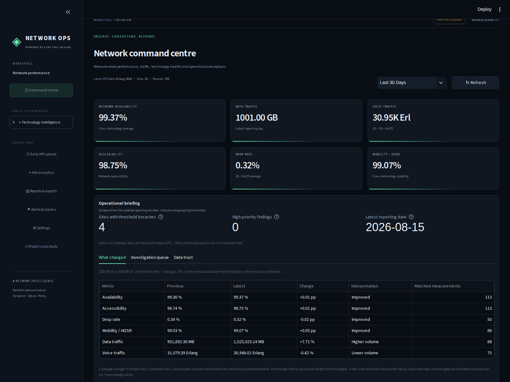
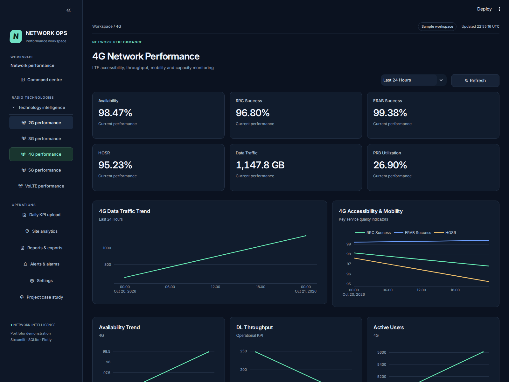
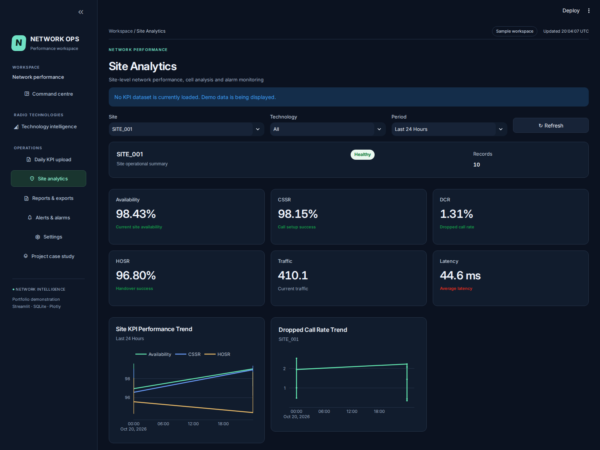

# Network Performance Dashboard

**Turn daily telecom KPIs into comparable trends, traceable investigations, and exportable reports.**

A Python engineering portfolio project by **Leonard Oluka**, with a Sentinel-inspired Streamlit interface. Built to demonstrate network-domain analysis, data-quality handling, interactive visualization, persistent imports and explainable decision support.

> Sample and uploaded KPI data only. No real company-network access, trained predictive AI, production impact or financial savings are claimed.

## Review the project

- **In the app:** open **Project case study** for a five-minute guided review.
- **Engineering narrative:** [Case study, decisions, calculation methods and limits](docs/CASE_STUDY.md).
- **Working evidence:** run the app, inspect the source and execute `python -m unittest discover -s tests -v`.
- **Automated verification:** regression CI plus a browser workflow that captures real desktop/mobile screenshots. Check Actions for its latest outcome.

## What makes the analysis useful

| Reviewer question | Implemented answer |
| --- | --- |
| What changed? | Latest-two-reporting-date comparisons on matched site/counter pairs, with reporting gaps labeled. |
| Is growth just new coverage? | Added/removed site counts and exclusion of unmatched measurements from comparison. |
| What needs investigation? | Latest-day rule-based queue, visible thresholds, suggested owners and source evidence. |
| Can I trust the measurements? | Valid percentage-cell coverage, invalid values, repeated keys, missing site IDs and reporting age. |
| Can I share the evidence? | Investigation CSV and existing filtered CSV, Excel and PDF report workflows. |

## Project overview

Network teams often need to review performance across several technologies, sites, and reporting periods. This application brings those workflows into a Streamlit interface with an overview dashboard, technology-specific views, KPI uploads, site analytics, and reports.

The project demonstrates practical skills in Python development, data analysis, interactive visualization, SQLite integration, and dashboard design.

## Features

- **Network overview:** Review summary metrics and performance visualizations.
- **Technology dashboards:** Dedicated views for 2G, 3G, 4G, 5G, and VoLTE.
- **KPI analysis:** Explore technology-specific indicators such as availability, call setup success, dropped calls, handover success, traffic, and resource utilization.
- **KPI upload workflow:** Upload and validate KPI data, with database summary and upload-history functionality.
- **Site analytics:** Explore performance at the site level.
- **Reporting:** Generate performance reports, including PDF reporting with ReportLab.
- **Additional pages:** Alarm and settings interfaces.

Available metrics and behavior depend on the selected page, technology, and data. This is a portfolio demonstration; production deployment and live data integration require project-specific configuration and validation.

## Sentinel interface

The dashboard now uses the visual language of [Sentinel](https://github.com/leonardoluka15-del/Sentinel): a charcoal workspace, mint accents, a persistent left navigation sidebar, compact metric cards, subtle panel borders, and matching Plotly charts. Dark is the default; Settings retains the Light appearance and existing refresh controls.

This is still the original Streamlit application, with its existing KPI database, uploads, site analysis, reports, and technology views. It does not start the standalone Sentinel simulator or replace uploaded KPI data with Sentinel telemetry. Continue to launch it with `streamlit run app.py`; existing Streamlit hosting can keep the same entry point.

The navigation shell lives in `navigation.py`; shared presentation tokens and charts live in `sentinel_theme.py`; the responsive CSS lives in `assets/sentinel.css`. Demo/sample-data labeling is retained.

### Interface verification

```bash
python -m unittest discover -s tests -v
```

The regression suite renders all twelve pages in an isolated copy and checks analytical edge cases, sidebar routing, technology routing, theme switching, and chart rendering. It leaves the repository's KPI database unchanged. This verifies application execution and controls, not pixel-level browser appearance.

## Technology stack

| Technology | Purpose |
| --- | --- |
| Python | Application logic and data processing |
| Streamlit | Interactive application interface |
| Pandas | Data manipulation and analysis |
| NumPy | Numerical processing |
| Plotly | Interactive charts |
| SQLite | Local KPI data storage |
| OpenPyXL | Excel file support |
| ReportLab | PDF report generation |

## Run locally

Install Python and Git, then run the following commands from your terminal.

### 1. Clone the repository

```bash
git clone https://github.com/leonardoluka15-del/Network-Performance.git
cd Network-Performance
```

### 2. Create a virtual environment

```bash
python -m venv .venv
```

Activate it on **Windows PowerShell**:

```powershell
.venv\Scripts\Activate.ps1
```

Or on **macOS / Linux**:

```bash
source .venv/bin/activate
```

### 3. Install dependencies

```bash
python -m pip install --upgrade pip
python -m pip install -r requirements.txt
```

### 4. Start the dashboard

Run this command from the repository root:

```bash
python -m streamlit run app.py
```

Open the local URL printed by Streamlit, usually `http://localhost:8501`.

## Explore the demo

1. Start with the overview page.
2. Use the navigation to explore the technology dashboards and site analytics.
3. Visit the KPI upload page to review the upload workflow and validation requirements.
4. Open the report page to explore reporting options.

The repository includes `network_kpi.db` with sample data. Use a local copy when experimenting with uploads or database changes.

## Repository structure

```text
Network-Performance/
├── app.py                    # Streamlit entry point
├── navigation.py             # Shared application navigation
├── page_layout.py            # Shared layout helpers
├── technology_dashboard.py   # Technology dashboard implementation
├── overview_data.py          # Overview data helpers
├── data/
│   └── database.py           # Database and KPI data functions
├── pages/                    # Overview, upload, analytics, reports, and other pages
├── network_kpi.db            # Sample SQLite database
├── requirements.txt          # Python dependencies
└── README.md
```

## Dashboard screenshots

Screenshots are captured from the running sample-data application. The browser workflow refreshes them after interface changes; check its latest successful run before treating these images as the current build.

### Network overview



### 4G technology dashboard



### Site analytics



## Custom dashboard services

I build custom Python and Streamlit dashboards to help teams explore their data and produce clear reports.

Services include:

- KPI and business performance dashboards.
- Excel and CSV data analysis and visualization.
- Data upload and validation workflows.
- Automated reporting and PDF report generation.
- Dashboard customization for a team's metrics, branding, and workflow.

**Custom dashboard projects start from €250.** Final pricing depends on the agreed scope, data sources, integrations, and delivery requirements.

To discuss a project, contact me on [LinkedIn](https://www.linkedin.com/in/oluka-leonard-onyedikachi-5a9554194/) with a short description of your data, required metrics, and expected deliverables.

## Author

**Leonard Oluka**

- [GitHub](https://github.com/leonardoluka15-del)
- [LinkedIn](https://www.linkedin.com/in/oluka-leonard-onyedikachi-5a9554194/)
